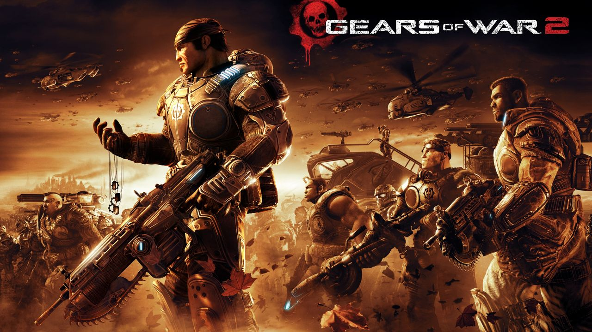

# Gears of War 2 for PS5

The Xbox 360 version of Gears of War 2 (Title Update 6), running natively on a jailbroken PS5 as a
homebrew app: **native 4K at 60 frames a second** in most of the game played so far.

No game files are included. You need your own copy of the game.

Built on [COGBox](https://github.com/Shagg88/COGBox) by **[Shagg88](https://github.com/Shagg88)**: its
Gears of War 2 static recompilation (Gears2-Native), game fixes and ReXGlue patches made this port possible.
COGBox itself (the Windows ports of Gears 2, 3 and Judgment, and its launcher) is at [Shagg88/COGBox](https://github.com/Shagg88/COGBox).

## Install
1. Download `GearsOfWar2-PS5-1.0.zip` from the [release](https://github.com/chonzytron/Gears-of-War-2-PS5/releases/tag/v1.0)
   and copy its `PPSA94120` folder to `/data/homebrew/` on the PS5.
2. Put your files in `/data/homebrew/PPSA94120/install/`:
   - Gears of War 2 (USA) (En,Fr,De,Es,It,Zh,Ko,Pl,Ru,Cs,Hu) disc image (`.iso`), game version 0.0.0.5
   - Title Update 6, the package file from your Xbox 360's
     `Content/0000000000000000/4D53082D/000B0000/` (e.g. `TU_16L621D_000000K000000.00000000001G5`), as it is
   - Optional: your Gears of War 2 DLC packages (`.../4D53082D/00000002/`)
3. Start the app.

**First start:** a screen checks your files against the ones this build was made from and prepares the game
(Title Update 6 and any DLC are unpacked; seconds). It then offers to delete the packages it no longer needs
(**Cross** deletes, **Circle** keeps); the disc image stays, the game reads from it. Later starts go straight
to the game.

**Controls:** Cross/Circle/Square/Triangle = A/B/X/Y, L1/R1 bumpers, L2/R2 triggers, Options = Start,
touchpad click = Back. Rumble on the DualSense.

## Settings
Optional: copy `gow2.example.toml` to `gow2.toml` in the app's folder and change a line.

| Setting | Default | What |
|---|---|---|
| `resolution_scale` | `3` | Drawing resolution: 1 = 720p, 2 = 1440p, 3 = native 4K |
| `ps5_display_height` | `2160` | TV output: 2160, 1440 or 1080 |
| `gow2_max_fps` | `60` | The engine's frame-rate limit: 60, or 0 for the game's own 30 (with `vsync = true`) |
| `vsync` | `false` | `true` holds the game to every second refresh, as on the Xbox 360 |
| `ps5_motion_blur` | `false` | The game's motion blur (the 60 was measured without it) |
| `ps5_language` | `"auto"` | auto, english, french, german, spanish, italian, polish, russian, korean, chinese |
| `ps5_skip_intro_videos` | `true` | Skip the Epic / Microsoft Game Studios logos (the story films still play) |
| `ps5_show_fps` | `false` | Frame counter in the corner |
| `ps5_install_cleanup` | `"ask"` | After the first start: ask, keep or delete the unneeded packages |
| `ps5_prepare_screen` | `true` | The progress screen on the first start |
| `ps5_perf_log` | `false` | Detailed performance lines in the log |
| `ps5_capture` | `0` | A screenshot every N seconds into `logs/` (0 = off) |
| `log_level` | `"info"` | Log detail |

The speed-ups (`ps5_resolve_forward`, `ps5_forward_*`, `ps5_skip_dead_transfers`, `ps5_dynamic_constants`, ...)
are on by default and only need turning off if something looks wrong; `gow2.example.toml` lists each one.

## Status
Release 1.0, tested over 31 runs on one PS5:
- **Played:** the menus, Training, the solo campaign started from the menus, Chapter 1 (Desperation) to the
  hospital's ending cinematic, Chapter 2, and the start of Chapter 3 (Roadblocks) with its real-time opening
  cinematic. No crashes in the last runs.
- **Frame rate at native 4K:** 60 in most play; Chapter 3's opening cinematic 57-60; the heaviest scenes
  (4,000+ draws a frame, e.g. an alley in Chapter 3) dip to the mid 50s. Expect short hitches when the game
  streams a new area or first meets a shader (rarer as the pipeline store in `UserData/` fills).
- **Not tested:** the rest of the campaign, split-screen and online co-op, multiplayer, Horde, DLC content.

Report problems with the chapter, what you saw, and the `logs/` folder (`gow2_<n>.log`).

## What the PS5 port adds
- A PS5 platform for the ReXGlue SDK ([`Gears2-Native/ps5/sdk/rexglue_ps5.patch`](Gears2-Native/ps5/sdk/rexglue_ps5.patch),
  carried over from Dead Space 2's): memory, threads, the disc image read in place, DualSense input, audio and
  video output. COGBox's game layer (its 36 game hooks: untiled rendering, texture pool, GPU-wait and frame-rate
  fixes) compiled for the PS5 ([`Gears2-Native/ps5/cogbox_ps5.patch`](Gears2-Native/ps5/cogbox_ps5.patch)).
- The game prepared on the console from your own files, with a first-start screen.
- 60 frames a second (the game ran at 30 on the Xbox 360), native 4K.
- Graphics work for that on the SDK's Xenos emulation, each change checked picture for picture: Direct3D's
  clears without the 360's 4x MSAA trick, resolved pictures (shadow atlas, bloom, HDR, depth of field, scene
  depth) written straight into the textures that read them and no longer into memory, EDRAM copies left out
  where the next draw covers them, shader constants bound by dynamic offsets, cheaper memory tracking, larger
  GPU submissions on a thread of their own, cheaper command-processor timing.
- Fixes found on the way: the network layer off Windows (the solo campaign runs as a network session; FreeBSD's
  socket addresses, non-blocking sockets the PS5 allows), write watches on 16 KB host pages, the pipeline
  store not growing on the PS5's C library, a texture exponent-bias bug that flashed new surfaces white, a
  teal cast from unclipped clears.
- Logs, slow-frame lines, a profiler and crash reports in `logs/`; L3+R3 marks for testers (`ps5_mark_button`).

Building from source: [Gears2-Native/ps5/BUILD.md](Gears2-Native/ps5/BUILD.md) (the recompiled code is made
from your own `default.xex` and `default.xexp`; none of it is in this repository). The console-run optimisation
log: the Project section of [CLAUDE.md](CLAUDE.md).

## Credits
Every project this port was built from or used on the way to 1.0:

**The game's recompilation**
- **[Shagg88](https://github.com/Shagg88)** and COGBox's contributors: [COGBox](https://github.com/Shagg88/COGBox)
  (Gears2-Native). Its Gears of War 2 recompilation (manifest, codegen templates, 36 game hooks), its game layer
  (untiled rendering, texture pool, GPU/query-wait and frame-rate fixes, config install) and its 100+ ReXGlue SDK
  patches are what this port is made from (MIT).
- **[santiquiroz](https://github.com/santiquiroz)**: [gears-of-war-2-pc-port](https://github.com/santiquiroz/gears-of-war-2-pc-port),
  another Gears of War 2 recompilation with an Android Vulkan build. Four of its SDK patches are in this port:
  the texture exponent-bias fix that stopped new surfaces flashing white (0019), the Vulkan resolve write barrier
  (0020), unclipped draws' vertex shaders run on the CPU, which fixed a teal cast (0033), and vertex buffers
  requested again each frame, which fixed stretched armour (0059, first found in a Gears 3 recompilation)
  (BSD-3-Clause).

**The runtime**
- **[ReXGlue](https://github.com/rexglue/rexglue-sdk)**: the Xbox 360 recompilation toolkit, codegen and runtime
  (kernel, Xenos GPU emulation on Vulkan), at `nightly-20261002-bd833a2a`.
- **[Xenia](https://github.com/xenia-project/xenia)**: the Xbox 360 emulator ReXGlue's kernel, GPU and file
  system come from, and its Canary and Edge forks, from which COGBox took parts of its renderer.
- The libraries built into the program through the SDK: [SDL](https://github.com/libsdl-org/SDL),
  [FFmpeg](https://github.com/wmarti/FFmpeg) (with the XMA decoder), [Dear ImGui](https://github.com/ocornut/imgui),
  [fmt](https://github.com/fmtlib/fmt), [spdlog](https://github.com/gabime/spdlog),
  [toml++](https://github.com/marzer/tomlplusplus), [xxHash](https://github.com/Cyan4973/xxHash),
  [SIMDe](https://github.com/simd-everywhere/simde), [utfcpp](https://github.com/nemtrif/utfcpp),
  [libmspack](https://github.com/kyz/libmspack), [o1heap](https://github.com/pavel-kirienko/o1heap),
  [CLI11](https://github.com/CLIUtils/CLI11), [inja](https://github.com/pantor/inja),
  [Vulkan Memory Allocator](https://github.com/GPUOpen-LibrariesAndSDKs/VulkanMemoryAllocator), Khronos'
  [Vulkan-Headers](https://github.com/KhronosGroup/Vulkan-Headers), [glslang](https://github.com/KhronosGroup/glslang)
  and [SPIRV-Tools](https://github.com/KhronosGroup/SPIRV-Tools), and
  [nlohmann/json](https://github.com/nlohmann/json) (in COGBox's game layer).

**The PS5 side**
- **[elripalda](https://github.com/elripalda)**: the [GTA IV PS5 port](https://github.com/elripalda/gta4-ps5)
  (and its fork [chonzytron/gta4-ps5](https://github.com/chonzytron/gta4-ps5)), where ReXGlue was first made to
  run on a PS5. Its platform layer is the base of this one (GPL-3.0).
- **[chonzytron/Dead-Space-2-PS5](https://github.com/chonzytron/Dead-Space-2-PS5)**: the Dead Space 2 PS5 port.
  Its PS5 patch for ReXGlue, app, installer, Linux test build, diagnostics, tools and Xenos-emulation speed-ups
  (resolve forwarding, the submission thread, volatile pages and more) were carried over and built on here.
- **[bifftannen1](https://github.com/bifftannen1)**: [Dead Space 2 Recomp](https://github.com/bifftannen1/Dead-Space-2-Recomp),
  the recompilation the Dead Space 2 port is made from. Its PDB-named Direct3D code identified Gears 2's
  `D3D::ClearRect` / `ClearRects` for the full-resolution clears.
- **[Nazky](https://github.com/Nazky)**: [ps5-plume-triangle](https://github.com/Nazky/ps5-plume-triangle), which
  builds the PS5 toolchain and provides the Vulkan app's link recipe, CRT, libc and the `ps5-native-tool` signer.
- **[mihawk-99](https://github.com/mihawk-99)**: [PS5_Mesa](https://github.com/mihawk-99/PS5_Mesa), the PS5's
  Vulkan driver (RADV), and [PS5_PayloadSDK](https://github.com/mihawk-99/PS5_PayloadSDK), the compilers,
  headers, libc++ and platform library.
- **[ps5-payload-dev](https://github.com/ps5-payload-dev)**: the [PS5 payload SDK](https://github.com/ps5-payload-dev/sdk)
  and the [pacbrew-repo](https://github.com/ps5-payload-dev/pacbrew-repo) prebuilt PS5 libraries.
- Also consulted: [mpereiraesaa/prospero-win](https://github.com/mpereiraesaa/prospero-win) (PS5 homebrew).

An unofficial fan project, not affiliated with Microsoft, Epic Games or The Coalition. "Gears of War" and
"Xbox 360" are trademarks of Microsoft.

## Licence
The PS5 files (`Gears2-Native/ps5/`, including the SDK patch) are GPL-3.0
([Gears2-Native/ps5/LICENSE](Gears2-Native/ps5/LICENSE)), derived from the GTA IV PS5 port and the PS5 payload
SDK's platform library. COGBox's code (`Gears2-Native/src`, the manifest, templates and patches) keeps its MIT
licence ([Gears2-Native/LICENSE](Gears2-Native/LICENSE), notices in
[THIRD_PARTY_NOTICES.md](Gears2-Native/THIRD_PARTY_NOTICES.md)), ReXGlue its BSD-style one. None of these cover
the game.
